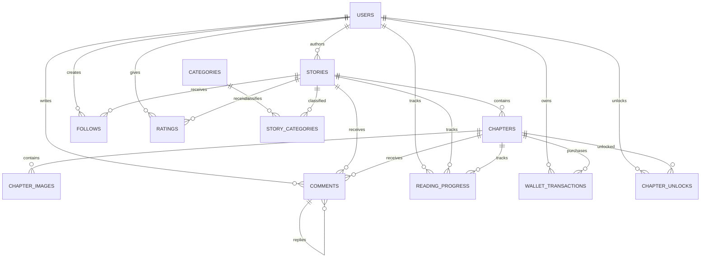

# Database Model

Các bảng được mô hình hóa bằng JPA entity trong từng module. Controller và service hiện vẫn để trống để phát triển nghiệp vụ sau.

## Entity relationship diagram

## Entity mapping

| Module | Entity | Table | Main foreign keys |
|---|---|---|---|
| `user` | `User` | `users` | - |
| `story` | `Story` | `stories` | `author` currently remains legacy text |
| `chapter` | `Chapter` | `chapters` | `story_id` |
| `chapterimage` | `ChapterImage` | `chapter_images` | `chapter_id` |
| `follow` | `Follow` | `follows` | `user_id`, `story_id` |
| `comment` | `Comment` | `comments` | `user_id`, `story_id`, `chapter_id`, `parent_id` |
| `rating` | `Rating` | `ratings` | `user_id`, `story_id` |
| `readingprogress` | `ReadingProgress` | `reading_progress` | `user_id`, `story_id`, `chapter_id` |
| `wallettransaction` | `WalletTransaction` | `wallet_transactions` | `user_id`, `chapter_id` |
| `chapterunlock` | `ChapterUnlock` | `chapter_unlocks` | `user_id`, `chapter_id`, `transaction_id` |
| `category` | `Category` | `categories` | - |
| `storycategory` | `StoryCategory` | `story_categories` | `story_id`, `category_id` |

## Implementation notes

- Các quan hệ đang dùng `FetchType.LAZY` để tránh tải toàn bộ dữ liệu liên quan.
- Các bảng follow, rating, reading progress và chapter unlock có unique constraint chống dữ liệu trùng.
- Các repository mới đã kế thừa `JpaRepository`.
- `Story.author` hiện vẫn là `String`; khi chuyển sang quan hệ thật, nên đổi thành `author_id` tham chiếu `users.id`.
- Khi triển khai production, nên dùng Flyway hoặc Liquibase thay cho `ddl-auto: update`.
